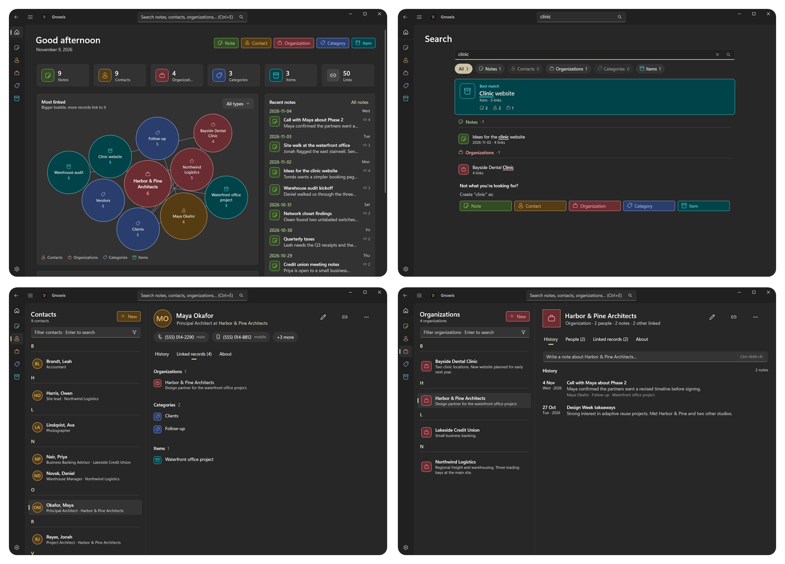

# Gnoseis for Windows

Gnoseis is a CRM application that can also be used as an all-purpose knowledge manager.
It stores all data on the device. This is the Windows (WinUI 3) version, ported from
[Gnoseis for Android](../../Android/Gnoseis-Android).

The Windows app uses **the same SQLite database format** as the Android app. A `gnoseis_data` file
or backup from Android can be used on Windows as long as it's schema version 3 or earlier (Android
0.3.0 writes version 3), and a Windows database or backup can be used on Android 0.3.0 or later. See [Supported schema versions](#supported-schema-versions).

<p align="center">
  
</p>

More screenshots of the current release are in [screenshots](screenshots/).

## Features

Gnoseis for Windows 0.1.0 offers what Gnoseis for Android 0.3.0 offers, with the newer search from Android 0.4.0:

- Notes, contacts, organizations, categories and items: list, view, add, edit and delete.
- Link any record to records of other types, either by picking existing records or by creating a
  new linked record from a record's page.
- All records linked to a record shown on its page, by type with counts, and unlinked with Undo.
- Search across all record types, with ranked results, type filters and a best match, and create a
  record from a search that finds no record with that name.
- Back up the database to a file and restore it (Android: Settings › Import / Export).

Only on Windows: the contact, note, organization, category and item pages, the linked record trail,
and Outlook-style keyboard shortcuts (see [Windows user experience](#windows-user-experience)).

## Installing

Requires Windows 10 version 1809 (build 17763) or later, x64. Nothing else needs to be installed:
.NET and the Windows App SDK are in the zip.

1. Download `Gnoseis-v<version>-win-x64.zip` from the
   [releases page](https://github.com/boredace/Gnoseis-Windows/releases).
2. [Verify the download](RELEASING.md#verifying-a-download): compare its SHA-256 with the one in the
   release notes, and check its build attestation.
3. Unpack it anywhere and run `Gnoseis.exe`.

Releases before 1.0 aren't code-signed, so Windows warns about them. SmartScreen shows "Windows
protected your PC" the first time: select **More info**, then **Run anyway**. Where Smart App Control
(Windows 11) is on, it blocks unsigned apps. The SHA-256 and the attestation are how to check that a
download is genuine until then.

**Updating:** unpack the new version over the old one or beside it. Your data isn't touched.

**Uninstalling:** delete the folder. Data in `%LOCALAPPDATA%\Gnoseis` stays until you delete it too.

**Files from Android:** Windows opens databases and backups with schema versions 1 to 3 (Android
0.3.0 writes version 3), and upgrades older files to version 3. See
[Supported schema versions](#supported-schema-versions).

**No network:** the app makes no network connections: no update check and no telemetry. Web and
e-mail links in your notes open your browser or mail app.

## Solution layout

| Project | What it contains |
|---|---|
| `src/Gnoseis.Core` | .NET 10 class library: models, the Room-compatible SQLite data layer, repositories, backup/restore and validation. It has no UI code. |
| `src/Gnoseis.App` | The WinUI 3 desktop app (.NET 10, Windows App SDK 2.5, unpackaged, self-contained `.exe`). |
| `tests/Gnoseis.Core.Tests` | xUnit tests for the data layer, ported from Gnoseis for Android, plus database compatibility tests against the Room schema export. |
| `tools/Gnoseis.DemoData` | Console tool that creates a demo database (see [Demo database](#demo-database)). |

## Building and running

Requirements:

- Windows 10 version 1809 (build 17763) or later.
- The [.NET 10 SDK](https://dotnet.microsoft.com/download/dotnet/10.0).
- Visual Studio 2022 or later with the **Windows application development** workload (WinUI).

With Visual Studio, open `Gnoseis.sln`, select the `x64` platform and run **Gnoseis.App**
("Gnoseis (Unpackaged)" profile).

From the command line, build with Visual Studio's MSBuild (from a Developer PowerShell). `dotnet build`
can't build the WinUI project: it can't load Visual Studio's PRI packaging task.

```bash
msbuild Gnoseis.sln /restore /p:Configuration=Debug /p:Platform=x64
```

The tests need only the .NET SDK:

```bash
dotnet test tests/Gnoseis.Core.Tests
```

The app is then at `src\Gnoseis.App\bin\x64\Debug\net10.0-windows10.0.19041.0\win-x64\Gnoseis.exe`.
If it ever fails to start, the error is written to `crash.log` in the [data folder](#where-the-data-is-stored).

## Where the data is stored

```
%LOCALAPPDATA%\Gnoseis\gnoseis_data      the database (same file name as on Android)
%LOCALAPPDATA%\Gnoseis\settings.json     preferences, window position, recently opened records
```

**Portable mode:** to keep the data next to the app (for example on a USB stick), create an empty file
named `portable` (no extension) next to `Gnoseis.exe`. The database, `settings.json` and `crash.log`
then go in a `data` folder beside it, created the first time the app starts. If that folder can't be
written (for example under `Program Files`), the app says so instead of keeping the data somewhere
else. The zip comes without this file.

To keep the data somewhere else (for example for testing), set the environment variable
`GNOSEIS_DATA_FOLDER` to a folder before starting the app. It takes priority over portable mode.

**Settings › Database file › Open folder** opens the folder in use, and **Settings › About** shows it.

### Demo database

`tools/Gnoseis.DemoData` creates a demo database: the knowledge base of an independent IT consultant
with 10,000 records of each type, linked to each other (about 117,000 links). It contains:

- **Organizations**: clients, former clients, prospects, vendors and partners in 8 countries.
- **Contacts**: the people at these organizations, with job titles, phone numbers and e-mail addresses.
- **Categories**: a tag taxonomy (topics, status, sector and product tags) and client projects (`PRJ-2025-0412 …`).
- **Items**: servers, laptops, network devices, licences, service contracts, domains and certificates.
- **Notes**: five years of calls, tickets, meetings, maintenance logs, project updates, quotes,
  invoices, how-tos and quick notes.

All names are made up. The same `--seed` always gives the same data.

```bash
dotnet run --project tools/Gnoseis.DemoData -- --force
```

It writes `%LOCALAPPDATA%\Gnoseis-Demo\gnoseis_data`. It never writes into the real data folder.
Options: a different folder as the first argument, `--count N`, `--seed N`, and `--force` to replace
an existing demo file. To open the demo database, set `GNOSEIS_DATA_FOLDER` to
`%LOCALAPPDATA%\Gnoseis-Demo` before starting the app. The file can also be copied to Android.

### Using your Android database on Windows

Either:

1. On Android, open **Settings › Import / Export** and select **Export**. Copy the exported file to the
   PC. In Gnoseis for Windows, open **Settings › Restore database** and select the file. The file is
   checked before anything is replaced, and your current Windows data is kept as
   `gnoseis_data.before-restore-<date>.backup` in the database folder.

   **Or:**

2. Close Gnoseis for Windows, then copy the Android `gnoseis_data` file into `%LOCALAPPDATA%\Gnoseis\`.
   If the Android database folder also contains `gnoseis_data-wal`, copy it too, because it may hold
   the latest changes.

To go the other way, use **Settings › Back up database**. It writes a single self-contained file that
the Android app can import.

### Supported schema versions

The schema version is stored in the database file as `PRAGMA user_version`.

| Schema version | Written by | On Windows |
|---|---|---|
| 1 | Android before 0.2.4 | Opens. It's migrated to version 3 the first time it's opened or restored (see below). |
| 2 | Android 0.2.4 and 0.2.5 | Opens. It's migrated to version 3 the first time it's opened or restored (see below). |
| 3 | Android 0.3.0 and later, and this app | Opens as is. New databases and backups are version 3. |
| 4 or later | Not released yet | Doesn't open. The app explains that the file is from a newer version and leaves it unchanged. |

The migrations are the same as on Android:

- **1 to 2:** the tables don't change. Links that were stored more than once between the same two
  records are removed (the first one is kept), and indexes that Gnoseis doesn't use are dropped.
- **2 to 3:** every record gets the time it was created and last changed (`createdAt`, `updatedAt`),
  and every link the time it was made (`createdAt`), all in UTC epoch milliseconds. Existing records
  and links keep these empty, because their times aren't known. A new `Settings` table holds the
  time of the last backup (`lastBackupAt`) and of the last deletion of a record or link
  (`lastDeletionAt`). It starts empty.

Before migrating the database file, the app copies it to `gnoseis_data.before-v3-<date>.backup` in
the database folder. A restored version 1 or 2 backup is migrated on a temporary copy, so the backup
file itself isn't changed.

Android before 0.3.0 can't open a version 3 file, so update the Android app before copying a
Windows database or backup to it.

### Record times and settings

- A new record gets its created and updated time. Saving a record changes its updated time only if
  something was edited; saving without a change leaves the record as it was. A note's own date and
  time count as edits. The created time never changes.
- A new link gets its created time.
- **Back up database** saves the time of the backup in the backup file and, once the backup has
  succeeded, in the database. Deleting a record or removing a link saves the time of the deletion.
- A restore never changes these times: the restored database keeps what the backup holds.
- The Windows app doesn't show these times yet. It keeps them up to date, so the Android app shows
  the right backup reminder for a database that was used on Windows.

### Compatibility details

- The tables, columns, `PRAGMA user_version` (3) and Room's `room_master_table` identity hash
  (`d4a4ee67…`) are exactly the ones Room expects. The tests compare new and migrated databases
  against the Room schema export (`tests/Gnoseis.Core.Tests/RoomSchema/3.json`, copied from
  `Gnoseis-Android/app/schemas`).
- Ids are GUID strings and dates are epoch milliseconds, as on Android. Note dates are shown in UTC,
  like the Android app, so a note shows the same date on both platforms.
- Windows keeps the file in rollback-journal mode, so the main `gnoseis_data` file always holds all
  committed data. Room switches it back to WAL when Android opens it.
- A file that doesn't match (e.g. from a newer app version) is **never deleted or changed**. The
  app explains the problem and offers to start a new database, renaming the old file to
  `gnoseis_data.unusable-<date>`. The only file the app migrates is a version 1 file, after copying
  it as described above.

## Windows user experience

Gnoseis is meant to stay open all day, so the Windows version is built around quick capture, fast
switching and seeing related information at a glance.

- **Windows 11 title bar** with Back, the navigation pane toggle, and a search box that is always
  there (Ctrl+E or F3). Search suggests the best matching records as you type; Enter opens the search
  page, from 3 characters. Results are ranked: an exact title first, then titles that start with
  the search, then a word that starts with it, then the rest, and the record with more links first
  within each. The top result is shown as the **best match**, with its links per type; the others
  are grouped by type, with the matched part highlighted and a line of context (a contact's job and
  company, a note's day, the link count). Type chips with counts narrow the results to one or more
  types. Before you type, the page shows the recently changed records. Enter in a section's filter
  box opens the search for that section's type. Back returns to the same search. A contact is
  found as "Last, First" and as "First Last". When nothing is found, or
  nothing has exactly the name searched for, the results offer to create a note, contact,
  organization, category or item with that name: it opens ready to edit, with the name filled in (a
  contact's words split into first and last name).
- **Home**: an overview of the whole database. Buttons at the top add a note, contact,
  organization, category or item. Count tiles show how many records of each type there are (each
  opens its list) and how many links. **Most linked** shows the records with the most links as
  bubbles in their type's colours, bigger for more links, with dashed lines between records linked
  to each other; a type picker shows one type at a time, and a bubble opens its record. A chart
  shows the notes written on each of the last 14 days, and **Unlinked notes** lists the newest notes
  not linked to anything yet, each with a **Link** button. **Recent notes** and **Recently opened**
  list records with what they hold and their link counts. A reminder at the bottom says when the
  database has never been backed up, or when records changed or were deleted since the last backup,
  with **Back up now**. On a narrow window the sections stack in one column.
- **List and record side by side** in every section, like Mail and Outlook. You can move through the
  list with the arrow keys. A filter box narrows the list. Notes are grouped by *Today*,
  *Yesterday*, weekday and date, and the other lists by first letter.
- **Item page**, in the contact page's style: a header with the name and counts, the item's
  history (its notes, newest first) with a note box above it (Ctrl+Shift+N), and the other linked
  records in a side column with the comments under **About**. From 1700 px a reading pane shows the
  selected note in full.
- **Organization page**: the item page plus a **People** column of cards for the linked contacts,
  with phone and e-mail chips and how many notes each shares with the organization. Clicking a card
  narrows the history to the notes linked to both (Esc, the chip's × or a second click clears it).
  Contacts whose Company field says the organization's name but who aren't linked yet are offered
  with a **Link** button. On a narrower pane People are compact rows in the side column, or a tab.
- **Category page**: the comments under the header, a search box that narrows all five lists at
  once (notes, contacts, organizations, items, categories) and marks the matches, and the five lists
  as equal cards placed in 1 to 5 columns by width, each showing as many rows as fit the pane, with
  **Show all**. **+** on a list links a record of that type; on Notes it opens a note box in the
  list (Ctrl+Shift+N).
- **Note page**, built around the text: a header with the title, the day and time, and the
  commands; the text in a readable column, with clickable web and e-mail links, and when it was
  created and changed under it. The records it's linked to sit in a side column, contacts first,
  each type with a **+** to link one more. **Edit** (F2) or a double-click on the text edits
  the title, the text and the day in place (Ctrl+Enter or Ctrl+S saves; Esc cancels, and asks first
  when something changed). The layout follows the
  width of the record pane as on the contact page, with a compact header once the header scrolls
  away. **More** has **New linked**, **Copy note text** (Ctrl+C) and **Delete**.
- **Contact page**, built around the person: a header with the name, the job and company (the
  company opens its organization when it's linked, or offers **Link as organization**), and a chip
  per phone number and e-mail address that calls or writes (right-click to copy; the value is copied
  when no app handles it). Below it, a note box writes a note linked to the contact without leaving
  the page (Ctrl+Shift+N, Ctrl+Enter saves), and the contact's history lists its notes, newest
  first, with month headers, a filter, year chips and **Show older** for long histories. The
  organizations, categories and items sit in a side column, each with a **+** to link one more.
  The layout follows the width of the record pane: tabs on a narrow one, a side column from 860 px,
  and from 1700 px a reading pane that shows the selected note in full (Up and Down move through the
  notes). Once the header scrolls away, a compact header keeps the name, the year chips and the
  commands in view; Home returns to the top. **More** has **New linked**, **Copy contact details**
  (Ctrl+C) and **Delete**.
- **Unlink** from a linked record's context menu (right-click, Shift+F10 or the menu key). There's
  no confirmation: a message offers **Undo** (Ctrl+Z) until you close it or leave the page. The same menu
  has **Open** and **Show in … list**.
- **Linked records open beside the section**: a record opened from a record's page doesn't switch
  sections. The list column becomes **Opened records**, the trail of records opened from one another:
  the record picked in the list first, then each record opened from the one above it. A line above
  the record says where it was opened from. Alt+Left (or the mouse back button) steps back along the
  trail and, from its first record, returns to the list; Alt+Right (or the mouse forward button)
  returns to records stepped back from, until another link is opened. A record is never in the trail
  twice: opening one again goes to it. **Back to list** closes the trail, and **Show in … list** goes
  to the record's own section. In a narrow window the trail is a breadcrumb above the record.
  Search, Home and the navigation pane still open a record in its own section.
- **Editing happens in place** in the record pane, on one edit page for every type, with Save
  (Ctrl+Enter or Ctrl+S) and Cancel (Esc); an existing note is edited on its own page. A record created with **New linked** shows which record it will be
  linked to. You're asked before unsaved changes are lost, including when you click another record.
- **Linking** existing records uses a picker dialog with the same search, chips and best match as
  the search page, and multi-select. Records stay ticked through later searches and chips until
  you untick them; a strip shows how many are ticked, and **Show selected** lists them all. Records
  that are already linked are dimmed. When the search finds no record with that name, the picker offers to
  create one, linked to the record it was opened from; records already ticked are linked too.
- **Delete** asks first (the safe answer is the default), then moves on to the next record.
- **Colours per record type**: the same colours as Gnoseis for Android, in light and dark theme, so
  record types can be told apart at a glance (also with night light on). A high-contrast theme uses
  the system colours instead.
- **Remembers where you were**: window size and position, whether it was maximized, the navigation
  pane and the last section, plus the selected record in each section while the app is open.
- **Narrow windows** show one pane at a time; Back returns from a record to the list.
- **Keyboard**, following Outlook, Office and Windows: Ctrl+1 to Ctrl+6 switch sections, Ctrl+E or
  F3 searches everything, Ctrl+F finds on the current screen (the record page's search or filter box,
  else the list's filter box), Ctrl+N creates a record, F2 edits, Ctrl+Enter or Ctrl+S saves, Ctrl+K
  links, Del or Ctrl+D deletes, Ctrl+Z undoes an unlink, and F6 and Shift+F6 move between the search
  box, the navigation pane, the list and the record. Alt+Left or the mouse back button goes back, and
  Alt+Right or the mouse forward button goes forward along the trail of opened records. On a contact,
  organization or item, Ctrl+Shift+N writes a note (on a category, in its Notes list). Outside a text
  box, Ctrl+C copies the details of the record shown, or a note's text. Home scrolls a record page
  back to the top. Settings lists every shortcut.
- Fluent design with Mica, a light, dark or system theme, and screen-reader names and headings.

| Android | Windows |
|---|---|
| Navigation drawer | Navigation pane (expanded, compact or hidden, depending on window width) |
| Separate list and details screens | List and record side by side |
| Opening a linked record (a new screen on the back stack) | The record opens beside the section, in a trail of opened records in the list column; Back and Forward step along it |
| Floating "Add" button | **New** button in the list header (Ctrl+N) |
| Expandable FAB (link existing / new linked record) | **Link** (Ctrl+K) and **New linked** menu in the record's command bar (on a contact or a note, under **More**) |
| Contact details screen (fields, then linked records) | Contact page: phone and e-mail chips in the header, the notes as a history with a note box above it, the other linked records in a side column |
| New linked note from a contact | Note box on the contact page (or **Open full editor**) |
| Note details screen (text, then linked records) | Note page: the text in a readable column, edited in place, the linked records in a side column |
| Organization details screen | Organization page: People cards that filter the history, the history with a note box, the other linked records in a side column, contacts with its name offered for linking |
| Item details screen | Item page: the history with a note box, the other linked records in a side column |
| Category details screen | Category page: a search over all linked records and five equal lists (notes, contacts, organizations, items, categories) |
| Linked-record tab row | Side column sections per type with **Show all** and **+**; tabs on a narrow pane |
| Snackbar with Undo after unlinking | Info bar with **Undo** at the bottom of the record page |
| Link Records page | Link picker dialog |
| Search page | Search box in the title bar, with suggestions and a results page |
| Import / Export page | Settings page cards: theme, database location, back up, restore, shortcuts |


## Licensing

Gnoseis is dual-licensed:

1. **Open-Source License**: [GNU General Public License v3.0](LICENSE).
2. **Commercial License**: for proprietary, closed-source or commercial use, see
   [COMMERCIAL_LICENSE](COMMERCIAL_LICENSE).

By contributing to this project, you agree to license your contributions under both licenses.

The screenshots show fictional sample data.
